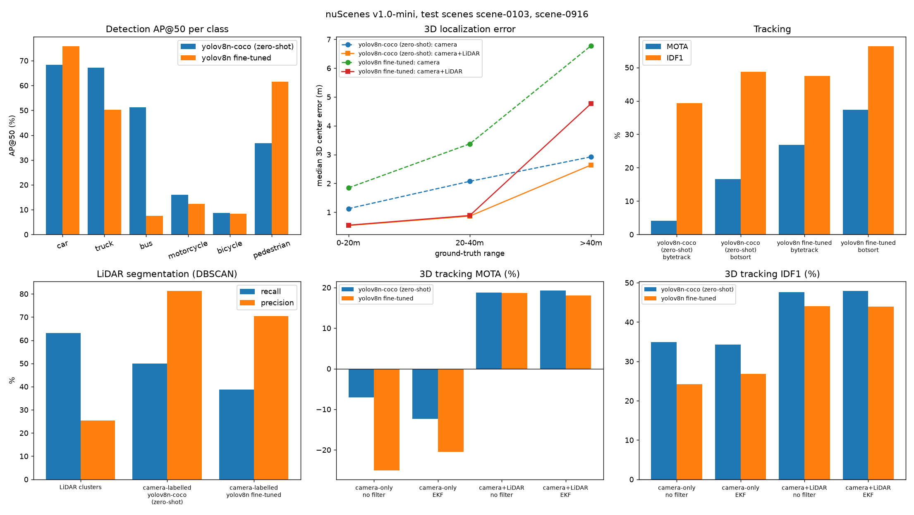

# Autonomous Driving Perception Benchmark (nuScenes)

A reproducible benchmark of a camera-first perception pipeline on **nuScenes v1.0-mini**:

1. **2D object detection**: YOLOv8n, COCO-pretrained (zero-shot) vs. fine-tuned on nuScenes
2. **3D localization**: monocular geometric depth vs. camera + LiDAR depth for each detected object
3. **2D multi-object tracking**: ByteTrack and BoT-SORT on all six cameras
4. **LiDAR segmentation**: ground removal + DBSCAN clustering of the point cloud, and the same
   clusters labelled by the camera detector (late camera–LiDAR fusion)
5. **3D multi-object tracking**: an Extended Kalman Filter in the global frame over all six
   cameras, with camera bearing and LiDAR or camera range as measurements

Every metric is computed in code against the official nuScenes annotations. `results/` is
written only by `scripts/evaluate.py`; nothing there is edited by hand.

## Results

Test scenes `scene-0103` and `scene-0916` (486 keyframe images, 3,460 GT boxes) on an Apple M4 (MPS) at imgsz 960.



| | YOLOv8n COCO, zero-shot | YOLOv8n fine-tuned (15 epochs) |
|---|---|---|
| Detection mAP@50 / mAP@50:95 | **41.4** / 16.6 % | 36.0 / **18.7** % |
| AP@50 car / pedestrian | 68.3 / 36.7 % | **75.9 / 61.6** % |
| AP@50 truck / bus | **67.2 / 51.2** % | 50.2 / 7.6 % |
| 3D center error, camera-only (median) | 1.38 m | 2.25 m |
| 3D center error, camera + LiDAR (median) | **0.68 m** | 0.69 m |
| Tracking MOTA / IDF1, ByteTrack | 4.0 / 39.3 % | 26.8 / 47.5 % |
| Tracking MOTA / IDF1, BoT-SORT | 16.5 / 48.8 % | **37.3 / 56.4** % |
| Camera-labelled LiDAR clusters, recall / precision | **49.9 / 81.2** % | 38.7 / 70.5 % |
| 3D tracking MOTA / IDF1, camera-only EKF | −12.4 / 34.3 % | −20.5 / 26.9 % |
| 3D tracking MOTA / IDF1, camera+LiDAR EKF | **19.3 / 47.9** % | 18.0 / 43.9 % |
| Detector latency (median) | 14.5 ms | 14.5 ms |

LiDAR-only segmentation (ground removal + DBSCAN, no camera, same for both columns): **84 % of
objects within 20 m** have a cluster on them (63 % within 50 m), with a median BEV centre error of 0.53 m.
Only 25 % of clusters lie on an annotated object, because nuScenes does not annotate walls,
poles or vegetation.

What the numbers say:

- **Fine-tuning helps where there is training data.** Cars and pedestrians make up about 87 % of
  the ~5,000 training boxes, and their AP rises sharply (pedestrian +25 points). That is why
  tracking improves so much: MOTA goes from 16.5 % to 37.3 % with BoT-SORT, with about a third of the false positives.
- **It hurts rare classes.** Trucks, buses, motorcycles and bicycles have only 90–270 training
  boxes each, and the validation scene used to pick the checkpoint contains no motorcycles or
  bicycles. Bus AP collapses (51 → 8 %), so overall mAP@50 drops even though mAP@50:95 rises.
  More data (full nuScenes) or class-balanced sampling is the fix, not more epochs.
- **LiDAR roughly halves the 3D error** within 40 m (median 0.54 m at 0–20 m vs. 1.1 m camera-only).
  Beyond 40 m the LiDAR is sparse and the errors grow for both methods.
- The fine-tuned model's **camera-only** depth is worse because it learned nuScenes' projected-3D
  boxes, which are taller than tight 2D boxes, while the height prior assumes tight boxes.
- **BoT-SORT beats ByteTrack** with both detectors on this data (camera-motion compensation helps
  a moving ego vehicle). MOTA is low overall because the GT includes many small, distant and
  partly occluded objects that a nano-size detector misses.
- **Camera labels make LiDAR clusters usable.** Keeping only clusters that a camera detection
  claims, and giving them its class, raises precision from 25 % (class-agnostic) to 81 %
  (same class) with the zero-shot detector, at about half the recall. Small, distant objects and
  rare classes are where recall is lost: motorcycle and bicycle recall is 16–22 %.
- **In 3D tracking, LiDAR range is what matters.** With the same detections and the same EKF,
  switching the range measurement from the camera height prior to LiDAR moves MOTA from −12.4 %
  to 19.3 % and IDF1 from 34 % to 48 %. Camera-only range errors (about 1 m median) push many
  matches past the 2 m threshold, which creates both a miss and a false positive.
- **The EKF does not beat a no-filter tracker on these test scenes.** With LiDAR, MOTA is within
  ±0.6 points of a tracker that just uses the latest measurement, and the median position error
  is slightly higher (0.61 vs. 0.55 m). On the development scenes the EKF cut ID switches by about
  60 %, but that did not carry over to the test scenes. Two likely reasons: the per-frame LiDAR
  error depends on the viewpoint and is correlated over time, so averaging does not cancel it; and
  2 Hz keyframes give the motion model little to work with. What the EKF does add is a
  **velocity estimate** (median error 0.52 m/s) that a per-frame method cannot give.

Full tables, including per-class and per-range numbers: [results/RESULTS.md](results/RESULTS.md).
Raw numbers: [results/metrics.json](results/metrics.json).

## Pipeline

```
nuScenes keyframes (6 cameras) ──► YOLOv8n ──► 2D boxes ──┬──► COCO mAP vs projected 3D GT
                                                          │
LIDAR_TOP sweep ──► project into camera ──────────────────┼──► depth per box ──► 3D center error
                                                          │
all camera frames (~12 Hz) ──► ByteTrack / BoT-SORT ──────┴──► MOTA / IDF1 vs instance ids

LIDAR_TOP sweep ──► ground removal (RANSAC per ring) ──► DBSCAN ──► clusters ──► recall / precision vs 3D boxes
                                                                      │
                                     camera detections (6 cameras) ───┴──► class-labelled clusters

camera bearing + LiDAR/camera range (6 cameras, 2 Hz) ──► EKF tracker (global frame) ──► 3D MOTA / IDF1, velocity error
```

| Module | What it does |
|---|---|
| [`adpb/nusc.py`](adpb/nusc.py) | Scene splits, class mapping, 2D GT from projected 3D boxes, LiDAR→image projection |
| [`adpb/detection.py`](adpb/detection.py) | YOLO wrapper mapped to the 6 classes, COCO-style AP with ignore regions, latency |
| [`adpb/localization.py`](adpb/localization.py) | Matches detections to GT and scores camera-only vs. LiDAR-assisted 3D centers |
| [`adpb/tracking.py`](adpb/tracking.py) | Runs Ultralytics trackers per camera sequence and scores them with `motmetrics` |
| [`adpb/lidar.py`](adpb/lidar.py) | Ground removal, DBSCAN clustering, camera labelling of clusters, and their evaluation against 3D boxes |
| [`adpb/ekf_tracking.py`](adpb/ekf_tracking.py) | EKF multi-object tracker (range/bearing measurements, Mahalanobis + Hungarian association) and its 3D evaluation |
| [`scripts/tune_clustering.py`](scripts/tune_clustering.py) | Grid search of the DBSCAN parameters on the training scenes |
| [`scripts/train_detector.py`](scripts/train_detector.py) | Exports train/val scenes to YOLO format and fine-tunes YOLOv8n |
| [`scripts/evaluate.py`](scripts/evaluate.py) | Runs everything on the test scenes and writes `results/` |

## Evaluation protocol

- **Split by scene, never by frame.** nuScenes-mini has 10 scenes. The official `mini_val`
  scenes (`scene-0103`, `scene-0916`) are the **test set** and are never used for training or
  model selection. Of the 8 `mini_train` scenes, `scene-0655` is held out as validation for
  fine-tuning and the other 7 are used for training.
- **Keyframes only for scoring.** Annotations exist only for 2 Hz keyframes: 486 test images across 6 cameras.
- **Classes:** car, truck, bus, motorcycle, bicycle, pedestrian. These are the nuScenes categories
  with a direct COCO equivalent, so the zero-shot and fine-tuned models solve the same task.
- **2D ground truth** is the image-space hull of each projected 3D box, clipped to the image.
  Boxes with nuScenes visibility < 40 % or no LiDAR/radar points are **ignore regions**:
  detections on them are neither rewarded nor penalised.
- **Detection:** COCO AP (`pycocotools`), up to 300 detections per image.
- **3D localization:** for each detection matched to GT (same class, IoU ≥ 0.5, score ≥ 0.25),
  the 2D box center is back-projected at an estimated depth and compared with the GT 3D box center.
  - *Camera-only:* `depth = f_y · H_class / box_height`, using a fixed height prior per class.
  - *Camera + LiDAR:* median depth of LiDAR points inside the central half of the box, plus a fixed
    per-class half-extent offset. Falls back to camera depth when there are fewer than 3 points.
- **Tracking:** the tracker sees every camera frame (~12 Hz) and is scored on keyframes. There are
  12 sequences (2 scenes × 6 cameras), and GT identities are nuScenes instance tokens. CLEAR-MOT and IDF1 come from `motmetrics`.
- **LiDAR segmentation:** one LIDAR_TOP sweep per keyframe, cropped to 50 m. Ground is a RANSAC
  plane per 10 m range ring; points 0.25–4 m above it are clustered with DBSCAN in bird's-eye view.
  `eps` and `min_samples` were picked by F2 score on the 8 training/validation scenes
  ([`results/clustering_tuning.json`](results/clustering_tuning.json)). A GT object (one of the 6 classes,
  ≥ 5 LiDAR points) is *found* if a cluster centre falls in its footprint enlarged by 0.5 m.
  Precision counts clusters that fall on an annotated object of **any** nuScenes category.
  *Camera-labelled* clusters: each detection (score ≥ 0.3) claims the cluster with the most projected
  points inside its box, and the cluster gets its class. These are scored class-aware.
- **3D tracking (EKF):** state `[x, y, vx, vy]` in the global frame with constant velocity. The
  measurement is `(range, bearing)` from the camera that saw the object, which is nonlinear in the
  state. Range noise is `a + b·r`, fitted separately for LiDAR and camera range on the validation
  scene `scene-0655`. Motion noise was set on two training scenes. Association uses the Hungarian
  algorithm on Mahalanobis distance with a 99 % χ² gate. A GT object is matched within 2 m (BEV,
  same class); objects must be visible in some camera and within 50 m.
  The *no filter* baseline uses the same detections and matching but outputs the latest measurement.
- **Latency:** detector only (pre-processing, inference and NMS) with 10 warm-up frames excluded.
  It is measured on the machine named in `results/RESULTS.md`.

## Reproduce

```bash
python3.12 -m venv .venv && source .venv/bin/activate
pip install -r requirements.txt
bash scripts/download_nuscenes.sh                 # ~4 GB, CC BY-NC-SA 4.0
mkdir -p weights && (cd weights && python -c "from ultralytics import YOLO; YOLO('yolov8n.pt')")
python scripts/train_detector.py --epochs 15      # optional: writes weights/yolov8n_nuscenes.pt
python scripts/tune_clustering.py                 # optional: DBSCAN grid search on training scenes
python scripts/evaluate.py                        # writes results/
```

## Limitations

- **Small test set.** nuScenes-mini has only 2 test scenes of about 20 s each: a Boston street
  with many pedestrians and a Singapore parking lot with parked bicycles and motorcycles. Treat
  differences of a few points as noise, and use the full nuScenes `val` split for claims that need
  to generalise.
- 2D GT from projected 3D boxes is looser than hand-drawn 2D boxes, which lowers IoU-based scores,
  especially mAP@50:95.
- nuScenes labels a bicycle or motorcycle *with its rider* as one object. COCO detectors also
  output the rider as a `person`, which shows up as pedestrian false positives for the zero-shot model.
- The 3D estimate keeps the 2D box center and only estimates depth. It is a per-object baseline,
  not a 3D detector and not a temporal filter.
- Height priors and LiDAR offsets are fixed constants chosen a priori and were not tuned on the test set.
- The DBSCAN clusterer uses a single 32-beam sweep, so recall drops sharply beyond 30–40 m.
  Nearby parked cars often merge into one cluster.
- The EKF tracker runs at the 2 Hz keyframe rate, where all six cameras and the LiDAR are
  synchronised and annotated. It does not use the ~12 Hz camera frames or the 20 Hz LiDAR sweeps.

## Roadmap

- [ ] Evaluate on the full nuScenes `val` split (150 scenes)
- [x] Temporal fusion: an EKF over LiDAR range and camera bearing per track, scored in 3D
- [x] LiDAR-only segmentation (ground removal + DBSCAN), and camera-labelled clusters
- [ ] Run the EKF on 20 Hz LiDAR sweeps and ~12 Hz camera frames, and use cluster centres as
      measurements
- [ ] Official nuScenes detection/tracking metrics (NDS, AMOTA) with a real 3D detector
- [ ] ONNX/TensorRT export with latency measured on an embedded GPU

## License

Code: MIT. The nuScenes data is © Motional and licensed CC BY-NC-SA 4.0.
